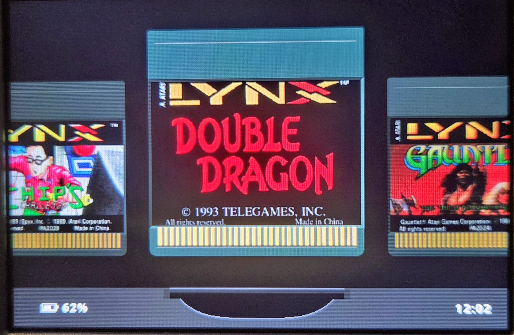

---

# What is slotPlus?

A slightly modified Slot. Has support for GBA, GBC, and GB titles as well as WonderSwan, WonderSwan Color and Atari Lynx.

## Atari Lynx

> [!IMPORTANT]
> Atari Lynx games need `lynxboot.img`, the Lynx boot ROM. It is **not included**. Put your own copy in `BIOS/`.

- **Games:** put `.lnx` and `.lyx` files in `Games/Lynx/`. They get their own shelf. The `Lynx` folders (`Games`, `Labels`, `Saves`, `States`) are created for you on first boot.
- **Label art:** optional PNGs go in `Labels/Lynx/<game name>.png`, roughly 284x190 px (about 1.5:1).
- **Core:** Lynx games run on Beetle Lynx.
- **Screen:** the Screen menu has an Atari Lynx page with its own Shader (Off, LCD3x, Grid or Dot) and Bezel. For a bezel, put your own PNGs in `Bezels/Lynx/`.
- **HDMI:** on handhelds with a mini-HDMI port, such as the RG SP, plug in a TV to play on it. Plug in or pull the cable at any time and Slot moves to the other screen and carries on where you were.
- **Carts:** Lynx carts are drawn as the curved-lip card, with its gold contacts behind a clear strip at the foot. Set `Config/cart_shell.txt` to give a single game a different shell.
- **Saves:** Beetle Lynx has no battery saves. Use save states and the resume state.

### Controls

| Press        | Does                                  |
|--------------|---------------------------------------|
| D-pad        | D-pad                                 |
| A / B        | A / B                                 |
| L1 / R1      | Option 1 / Option 2                   |
| Start        | Pause (the Lynx's Option button)      |
| Select       | Turned games: hold upright / turned   |
| Hold X / Y   | Turbo A / Turbo B                     |

### Games that turn

Some Lynx games were made to be held on their side. Play these with the handheld turned 90 degrees counter-clockwise, like the vertical WonderSwan games: the picture is drawn sideways at full size and comes out upright once you turn the handheld, and the D-pad follows the picture. Press toward the top of the picture for up. A, B, Option 1, Option 2 and Start are unchanged.

Press SELECT in a game that turns to hold the handheld the usual way instead: the picture is drawn upright and tall, with bars at the sides, and the D-pad goes back to normal. Press it again to turn the handheld back. Every launch starts turned. SELECT does nothing in other games.

Beetle Lynx knows many of these games, and slot also recognises Klax, Gauntlet III, Lexis and NFL Football by name, whichever dump you have. Every other game is drawn as normal.

For a game that needs it and is not recognised, add a line to `Config/lynx_rotation.txt`, using the game's file name without the extension:

The values are `auto` (let the core decide), `0` (never turn), `90` and `270` (the two ways a game can be made to be turned), `180`, and `manual`. If a game comes up upside down with the handheld turned, swap 90 for 270. With `manual`, SELECT goes to the core instead and each press turns the picture another quarter, so you can find the right setting and then write it into the file. An entry in the file wins over everything else.

> [!NOTE]
> The turned layout and its D-pad feel are new. If something feels wrong, please open an issue.

## WonderSwan / WonderSwan Color

- **Games:** put `.ws` and `.wsc` files in `Games/WS/`. They get their own shelf next to GBA, GB and GBC. The `WS` folders (`Games`, `Labels`, `Saves`, `States`) are created for you on first boot.
- **Label art:** optional PNGs go in `Labels/WS/<game name>.png`, roughly 324x132 px (about 2.45:1).
- **Core:** WonderSwan games run on Beetle WonderSwan (Cygne).
- **Screen:** the Screen menu has a WonderSwan page with its own Shader (Off, LCD3x, Grid or Simpletex) and Bezel. For a bezel, put your own PNGs in `Bezels/WS/`.
- **Carts:** WonderSwan carts have their own wide shape, with the oval nameplate on top and the bare board showing below the shoulder, and default to the shell the game came in: black for a WonderSwan game (`.ws`), frosted smoke-clear with the board showing through for a WonderSwan Color game (`.wsc`). Set `Config/cart_shell.txt` to give a single game a different shell.

### Controls (horizontal games)

The WonderSwan has two sets of four direction buttons: the X pad (left side) and the Y pad (right side).

| Press                  | Does                                              |
|------------------------|---------------------------------------------------|
| D-pad                  | X pad                                             |
| A / B                  | A / B                                             |
| Start                  | Start                                             |
| Hold **L1** + D-pad    | Y pad (up / right / down / left) |
| Hold **R1** + X / A / B / Y | Y pad (X = up, A = right, B = down, Y = left) |
| Select                 | Nothing in horizontal games (they can't be rotated) |

Picture-mode shortcuts are turned off for WonderSwan games, so L1 and R1 can act as the Y-pad modifiers.

### Vertical games

Games made for vertical play are recognized from the ROM. Play them one of two ways:

- **Device upright:** press SELECT and the picture turns upright (it shows at 2x with black bars at the sides).
- **Device turned 90 degrees counter-clockwise:** leave the picture sideways at full size.

Either way the D-pad is the Y pad, the four face buttons are the X pad, L1 is A and R1 is B. Upright, D-pad up is up in the game. Turned sideways, the buttons keep the WonderSwan's own directions. The L1 / R1 Y-pad modifiers above are for horizontal games only.

> [!NOTE]
> Vertical controls are new but I have tested with multiple games. If something feels wrong, please open an issue.

---

# What is slot?

A bespoke, Game Boy-centric frontend for the Anbernic RG SP.

Has support for GBA, GBC, and GB titles only.

> [!IMPORTANT]
> ROMs must be unzipped. slot does not read `.zip` or `.7z` files.

A full user guide can be found at [slot-cfw.fyi](https://slot-cfw.fyi).

Release notes can be found in the [changelog](CHANGELOG.md).

---

# What does it look like?

---

# Supported Devices

| Device             | Supported                  | Since Version |
|--------------------|----------------------------|---------------|
| Anbernic RG SP     | Yes                        | Always        |
| Anbernic RG34XX    | Yes                        | 1.4.0         |
| Anbernic RG34XXSP  | Yes (No Stick Support Yet) | 1.4.0         |
| Anbernic RG35XXSP  | Yes                        | 1.5.0         |
| Anbernic 35XX Plus | Yes                        | 1.5.0         |
| Anbernic RG28XX    | Yes                        | 1.6.0         |

If you have one of the untested devices, or have tried slot on a device not listed,
please [open an issue on GitHub](https://github.com/BrandonKowalski/slot/issues) and let me know how it went.

---

# AI Disclosure

The Rust frontend, and the SVGs on [slot-cfw.fyi](https://slot-cfw.fyi), were put together by Claude.
I reviewed everything that was produced. All documentation is 100% free-range, meatbag prose.

My goal with this project was to recreate the feeling of playing my GBA SP in the back seat as a kid,
but with a few modern creature comforts.

Nothing about this project is exciting or groundbreaking from a technological perspective, and as a
result, I delegated the glue code. mGBA and gpSP have been around forever and are the true stars of
this show. The incredible skeuomorphic art is the work of [Markus](https://github.com/MarkusMaribu), an
artist who saw the bare-bones version and offered to dress it up.

I understand if my use of AI is a dealbreaker for you. Just know it's the least interesting part of
what's here.

Figured I should share the end result of all the wasted water. ✌🏻
