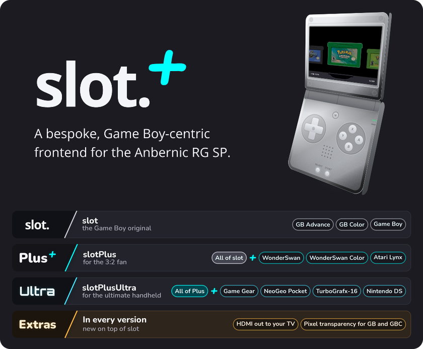
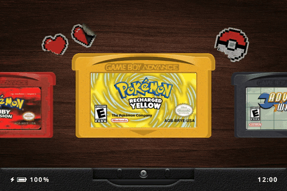
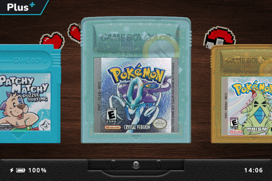
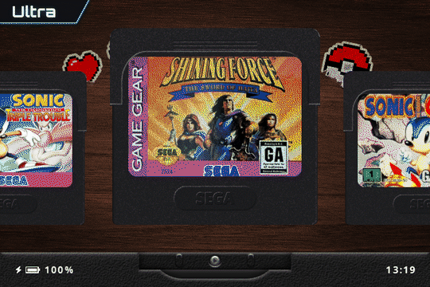
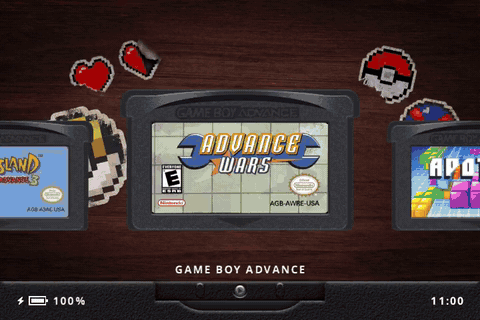

---

# What is slotPlus?

A slightly modified Slot. Alongside Slot's Game Boy Advance, Game Boy and Game Boy Color, it plays more handhelds, each on its own shelf with its own cart, and it can play on a TV over HDMI.

**See it in action, and find installing steps and what each system adds, at [nelynes.github.io/slotPlus](https://nelynes.github.io/slotPlus/).**

Each release comes in two versions. Pick the one you want from the [releases page](https://github.com/nelynes/slotPlus/releases):

- **`slot-plus.zip`, slotPlus:** Game Boy Advance, Game Boy and Game Boy Color, plus WonderSwan and Atari Lynx.
- **`slot-plusultra.zip`, slotPlusUltra:** everything in slotPlus, plus Game Gear, NeoGeo Pocket and TurboGrafx-16.

| System | Version | Put games in | Files | Core | BIOS |
|---|---|---|---|---|---|
| WonderSwan / Color | Plus and Ultra | `Games/WS/` | `.ws` `.wsc` | Beetle WonderSwan (Cygne) | Not needed |
| Atari Lynx | Plus and Ultra | `Games/Lynx/` | `.lnx` `.lyx` | Beetle Lynx | `lynxboot.img` in `BIOS/` |
| Sega Game Gear | Ultra | `Games/GG/` | `.gg` | Gearsystem | Not needed |
| NeoGeo Pocket / Color | Ultra | `Games/NGP/` | `.ngp` `.ngc` `.ngpc` | Beetle NeoPop | Not needed |
| TurboGrafx-16 / TurboExpress | Ultra | `Games/TG16/` | `.pce` (HuCards) | Beetle PCE Fast | Not needed |

> [!IMPORTANT]
> Atari Lynx games need `lynxboot.img`, the Lynx boot ROM. It is **not included**. Put your own copy in `BIOS/`.

**Installing:** for a fresh install, unzip and copy everything onto the Slot card. To upgrade, unzip and replace the `System` folder on your card with the new one. Switching between Plus and Ultra works the same way, and your games, saves and settings stay put. Going back from Ultra to Plus leaves the Game Gear, NeoGeo Pocket and TurboGrafx-16 games and saves on the card, without their shelves.

- **Folders:** each system's folders under `Games`, `Labels`, `Saves`, `States` and `Bezels` are created for you on first boot.
- **Carts:** each system has its own cart, drawn in Slot's look. WonderSwan games get a black cart, WonderSwan Color games a frosted clear one, and a HuCard turns over to go into the slot contacts first.
- **Cart Slot:** set Settings > General > Cart Slot to Bespoke and the slot on each shelf becomes the back of that system's handheld: a pearl WonderSwan and a Lynx II, plus a Game Gear, a carbon NeoGeo Pocket Color and a TurboExpress in Ultra. The Game Boy shelves keep Slot's own.

**Controls, label art sizes, bezels, saves, and how Lynx and WonderSwan games that turn sideways work are all in the [systems guide](SYSTEMS.md).**

## Label Art

- **Label art:** optional PNGs go in `Labels/<folder>/<game name>.png`.
- My copy of Cart studio is updated to support the new systems, go to: [Cart Studio+](https://nelynes.github.io/slotPlus-studio/)

## Playing on a TV

Both versions can show the picture on a TV over HDMI, on handhelds with a mini-HDMI port such as the RG SP.

- Plug the TV in before or after switching on. The shelf and games show on the TV at 1080p, with the sound there too, and the handheld's screen goes dark. The handheld is the controller.
- Plug in or pull the cable at any time, even mid-game. Slot saves the game, starts again on the other screen within a few seconds and picks up where you were.
- Closing the lid doesn't sleep the handheld while it's on the TV.

> [!NOTE]
> HDMI has been tested on the RG SP. The other supported handhelds with a mini-HDMI port should work the same way. If yours doesn't, please open an issue.

---

# What is slot?

A bespoke, Game Boy-centric frontend for the Anbernic RG SP.

Has support for GBA, GBC, and GB titles only.

> [!IMPORTANT]
> ROMs must be unzipped. slot does not read `.zip` or `.7z` files.

A full user guide can be found at [slot-cfw.fyi](https://slot-cfw.fyi).

Release notes can be found in the [changelog](CHANGELOG.md).

---

# What does it look like?

---

# Supported Devices

| Device             | Supported                                    | Since Version |
|--------------------|----------------------------------------------|---------------|
| Anbernic RG SP     | Yes                                          | Always        |
| Anbernic RG34XX    | Yes                                          | 1.4.0         |
| Anbernic RG34XXSP  | Yes                                          | 1.4.0         |
| Anbernic RG35XXSP  | Yes                                          | 1.5.0         |
| Anbernic 35XX Plus | Yes                                          | 1.5.0         |
| Anbernic RG28XX    | Yes                                          | 1.6.0         |
| Anbernic RG35XX-H  | Yes                                          | 1.7.0         |

If you have one of the untested devices, or have tried slot on a device not listed,
please [open an issue on GitHub](https://github.com/BrandonKowalski/slot/issues) and let me know how it went.

---

# AI Disclosure

The Rust frontend, and the SVGs on [slot-cfw.fyi](https://slot-cfw.fyi), were put together by Claude.
I reviewed everything that was produced. All documentation is 100% free-range, meatbag prose.

My goal with this project was to recreate the feeling of playing my GBA SP in the back seat as a kid,
but with a few modern creature comforts.

Nothing about this project is exciting or groundbreaking from a technological perspective, and as a
result, I delegated the glue code. mGBA and gpSP have been around forever and are the true stars of
this show. The incredible skeuomorphic art is the work of [Markus](https://github.com/MarkusMaribu), an
artist who saw the bare-bones version and offered to dress it up.

I understand if my use of AI is a dealbreaker for you. Just know it's the least interesting part of
what's here.

Figured I should share the end result of all the wasted water. ✌🏻

---

# Spread Joy!

I've spent a lot of time building slot.

If you enjoy using it and feel inclined to pay it forward, go do something nice for someone! ❤️
