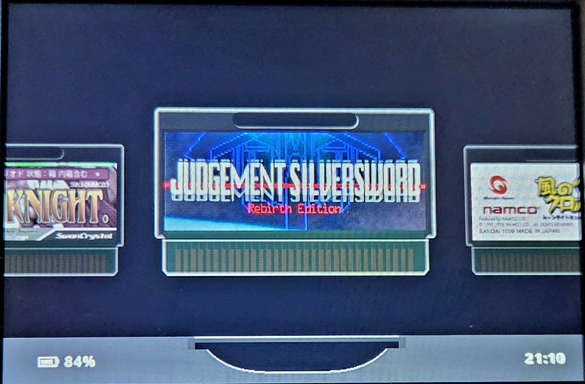

---

# What is slotPlus?

A slightly modified Slot. Alongside Slot's Game Boy Advance, Game Boy and Game Boy Color, it plays four more handhelds, each on its own shelf with its own cart:

| System | Put games in | Files | Core | BIOS |
|---|---|---|---|---|
| NeoGeo Pocket / Color | `Games/NGP/` | `.ngp` `.ngc` `.ngpc` | Beetle NeoPop | Not needed |
| Sega Game Gear | `Games/GG/` | `.gg` | Gearsystem | Not needed |
| Atari Lynx | `Games/Lynx/` | `.lnx` `.lyx` | Beetle Lynx | `lynxboot.img` in `BIOS/` |
| WonderSwan / Color | `Games/WS/` | `.ws` `.wsc` | Beetle WonderSwan (Cygne) | Not needed |

> [!IMPORTANT]
> Atari Lynx games need `lynxboot.img`, the Lynx boot ROM. It is **not included**. Put your own copy in `BIOS/`.

- **Folders:** each system's folders under `Games`, `Labels`, `Saves`, `States` and `Bezels` are created for you on first boot.
- **Label art:** optional PNGs go in `Labels/<folder>/<game name>.png`.
- **Screen menu:** each system has its own page, with its own shader and bezel. The Game Gear and NeoGeo Pocket come with a bundled bezel.
- **Carts:** each system has its own cart, drawn in Slot 1.7's look. WonderSwan games get a black cart, WonderSwan Color games a frosted clear one.

**Controls, label art sizes, bezels, saves, and how Lynx and WonderSwan games that turn sideways work are all in the [systems guide](docs/systems.md).**

---

# What is slot?

A bespoke, Game Boy-centric frontend for the Anbernic RG SP.

Has support for GBA, GBC, and GB titles only.

> [!IMPORTANT]
> ROMs must be unzipped. slot does not read `.zip` or `.7z` files.

A full user guide can be found at [slot-cfw.fyi](https://slot-cfw.fyi).

Release notes can be found in the [changelog](CHANGELOG.md).

---

# What does it look like?

---

# Supported Devices

| Device             | Supported                  | Since Version |
|--------------------|----------------------------|---------------|
| Anbernic RG SP     | Yes                        | Always        |
| Anbernic RG34XX    | Yes                        | 1.4.0         |
| Anbernic RG34XXSP  | Yes (No Stick Support Yet) | 1.4.0         |
| Anbernic RG35XXSP  | Yes                        | 1.5.0         |
| Anbernic 35XX Plus | Yes                        | 1.5.0         |
| Anbernic RG28XX    | Yes                        | 1.6.0         |

If you have one of the untested devices, or have tried slot on a device not listed,
please [open an issue on GitHub](https://github.com/BrandonKowalski/slot/issues) and let me know how it went.

---

# AI Disclosure

The Rust frontend, and the SVGs on [slot-cfw.fyi](https://slot-cfw.fyi), were put together by Claude.
I reviewed everything that was produced. All documentation is 100% free-range, meatbag prose.

My goal with this project was to recreate the feeling of playing my GBA SP in the back seat as a kid,
but with a few modern creature comforts.

Nothing about this project is exciting or groundbreaking from a technological perspective, and as a
result, I delegated the glue code. mGBA and gpSP have been around forever and are the true stars of
this show. The incredible skeuomorphic art is the work of [Markus](https://github.com/MarkusMaribu), an
artist who saw the bare-bones version and offered to dress it up.

I understand if my use of AI is a dealbreaker for you. Just know it's the least interesting part of
what's here.

Figured I should share the end result of all the wasted water. ✌🏻
