

---

# New in 3.1: Pokedaisy, and Play or Tinker

- **A PokeDaisy shelf.** Pokémon games in `Games/PokeDaisy/` play on [PokeDaisy](https://github.com/lidor30/pokedaisy), with its companion on X and its quick menu on Y.

One slotPlus with every system, in two editions, and Settings regrouped by what you're doing. Full notes are in the [3.1 release](https://github.com/nelynes/slotPlus/releases/tag/v1.16.0-plus3.1).

- **Two editions.** Both play every system. **slotPlus Core** comes set up for you and just plays. **slotPlus Ultra** has every option, and is what everyone on 3.0 updates into. [Which one is for you?](#which-edition)
- **Settings, regrouped.** The top level is now Look, Library, Play, Screen, Controls, Online and System. Your choices carry over. Looking for something? The [settings guide](SETTINGS.md#where-things-moved-in-31) shows where everything moved. And a line above the slot now says what each row does.
- **Fixes:** the Reset shortcut works again on every system with RetroAchievements.

> [!NOTE]
> **Updating from slotPlus 3.0 (the Plus edition)?** Check for Updates brings you slotPlus Ultra, with your games, saves and settings as they were. The Game Gear, NeoGeo Pocket, TurboGrafx-16 and DS shelves appear only if you put games in their folders.

## Last time, 3.0: The Cart Remembers

Your carts keep a record of how they've been played. Full notes are in the [3.0 release](https://github.com/nelynes/slotPlus/releases/tag/v1.16.0-plus3.0).

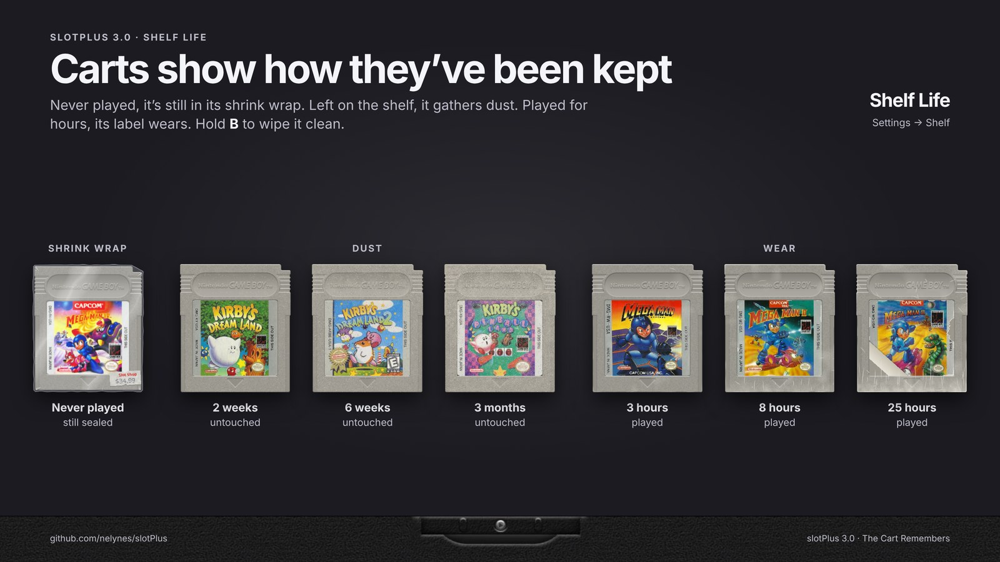
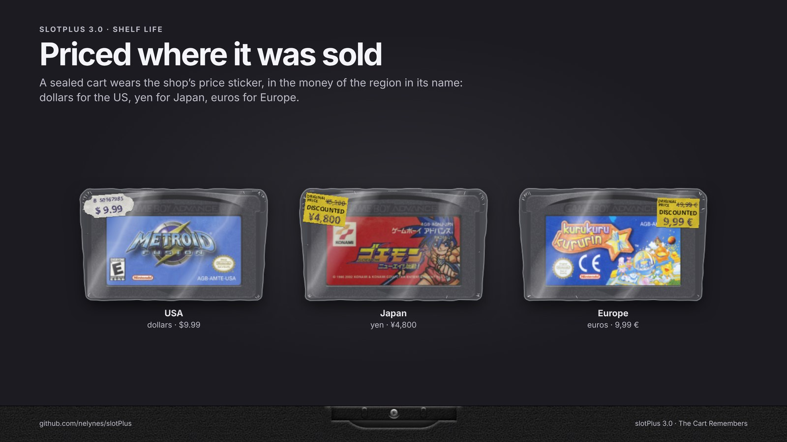

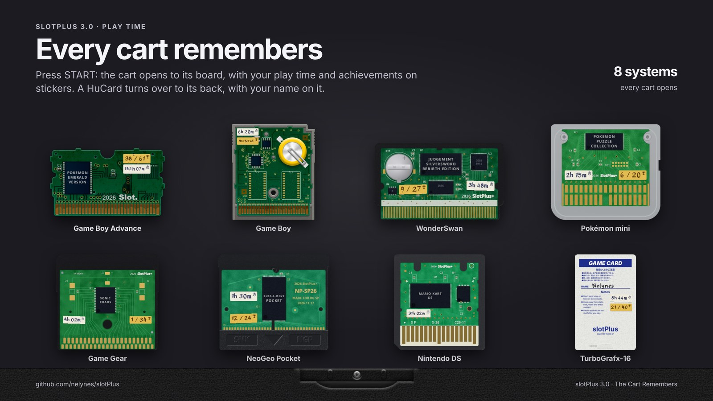
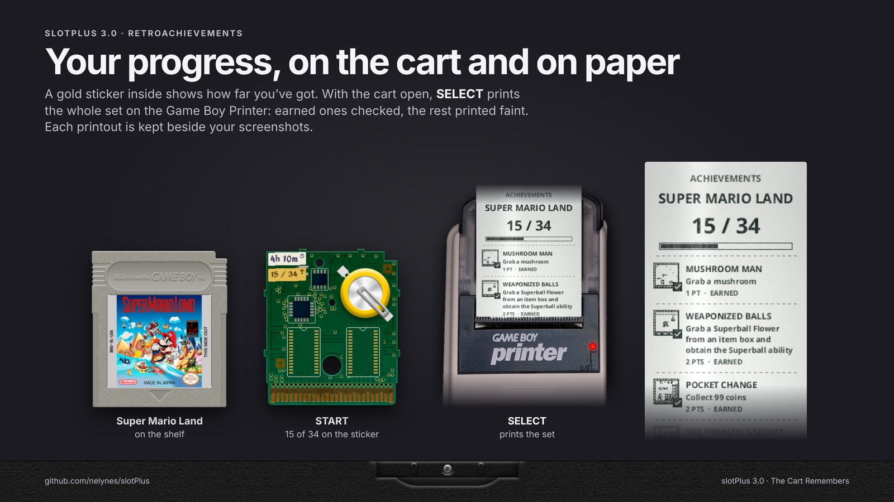

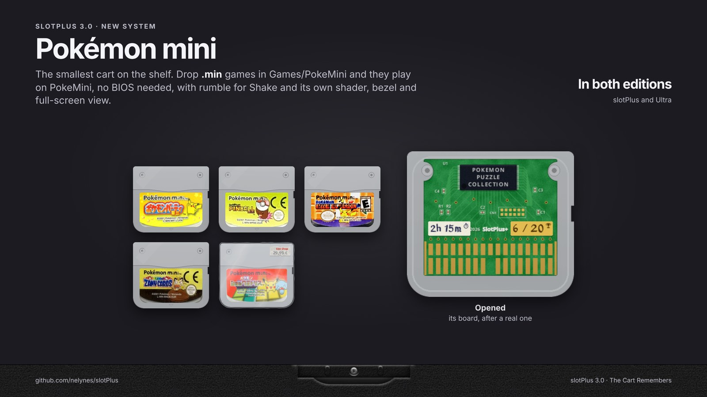
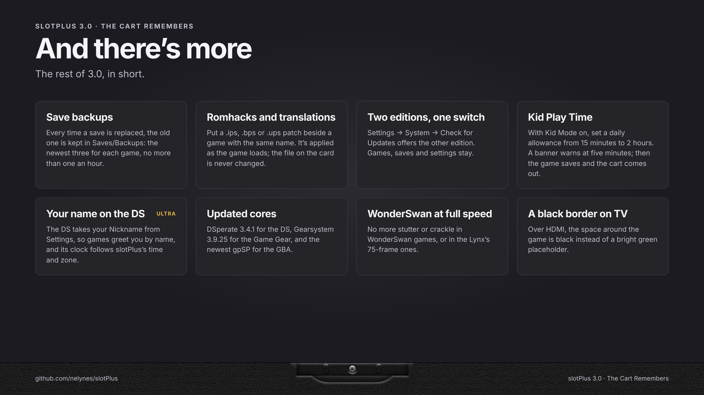

- **Shelf Life.** Games you've never played come shrink-wrapped with a price sticker, and the film tears off the first time you play. Carts left alone gather dust, and carts you play a lot show their wear. Hold B on a cart to clean it, or clean them all at once from Settings → Look → Shelf Life.
- **Every cart opens.** START opens any cart to show the board inside, now on every system: new boards for WonderSwan, Pokémon mini, Game Gear, NeoGeo Pocket and DS, with the back of a HuCard for the TurboGrafx-16. Your play time is handwritten on a sticker inside.
- **Achievements on the cart and on paper.** A gold sticker inside shows how far you've got, and SELECT prints the whole set on the Game Boy Printer.
- **Pokémon mini.**
- **Romhack and translation patches** (`.ips`, `.bps`, `.ups`) applied as the game loads.
- **Kid Play Time**, a daily limit for Kid Mode.
- **Save backups:** the last three versions of each save are kept.
- **New options in Settings are marked with a blue dot.**
- **The DS uses your Nickname and the real time**, and DSperate and Gearsystem are updated.
- **Fixes:** WonderSwan games run at full speed again, and there's no more green border on a TV.

# Coming Soon

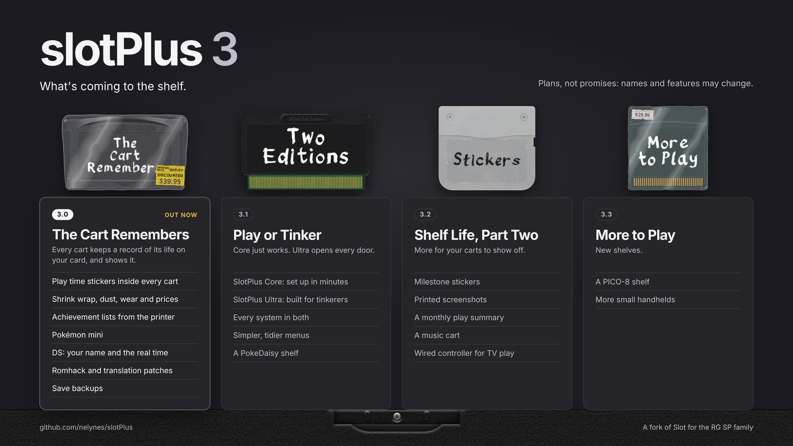

# What is slotPlus?

A modified Slot. Alongside Slot's Game Boy Advance, Game Boy and Game Boy Color, it plays more handhelds, each on its own shelf with its own cart, and it can play on a TV over HDMI.

**See it in action, and find installing steps and what each system adds, at [nelynes.github.io/slotPlus](https://nelynes.github.io/slotPlus/).**

## Which edition?

Both editions play every system, and a system only gets a shelf when it has games on the card. Pick by how much you want to set up, from the [releases page](https://github.com/nelynes/slotPlus/releases):

- **`slot-core.zip`, slotPlus Core:** for putting games on the card and playing. A gift, a child's handheld, or anyone who'd rather not open a menu. Each system comes set up, most options are a plain On or Off, and there are no accounts to sign in to. No RetroAchievements, RomM, Gamebit, in-game save-state menu or screenshots menu.
- **`slot-plusultra.zip`, slotPlus Ultra:** for tinkerers. Every option: RetroAchievements, RomM and Gamebit, save states with undo, screenshots, guides, and shaders, overlays and bezels for every system. The release's `slot-plus.zip` is the same download under its old name.

Switch between them any time from Settings → Online → Check for Updates, or by swapping the `System` folder. Your games and saves stay. The [settings guide](SETTINGS.md#which-edition-is-for-you) compares them in full.

| System | Put games in | Files | Core | BIOS |
|---|---|---|---|---|
| WonderSwan / Color | `Games/WS/` | `.ws` `.wsc` | Beetle WonderSwan (Cygne) | Not needed |
| Atari Lynx | `Games/Lynx/` | `.lnx` `.lyx` | Beetle Lynx | `lynxboot.img` in `BIOS/` |
| Pokémon mini | `Games/PokeMini/` | `.min` | PokeMini | Not needed |
| Sega Game Gear | `Games/GG/` | `.gg` | Gearsystem | Not needed |
| NeoGeo Pocket / Color | `Games/NGP/` | `.ngp` `.ngc` `.ngpc` | Beetle NeoPop | Not needed |
| TurboGrafx-16 / TurboExpress | `Games/TG16/` | `.pce` (HuCards) | Beetle PCE Fast | Not needed |
| Nintendo DS | `Games/NDS/` | `.nds` | DSperate | Not needed |
| PokeDaisy (Pokémon games for GBA, GB, GBC) | `Games/PokeDaisy/` | `.gba` `.gb` `.gbc` | PokeDaisy | Not needed |

> [!IMPORTANT]
> Atari Lynx games need `lynxboot.img`, the Lynx boot ROM. It is **not included**. Put your own copy in `BIOS/`.

**Installing:** for a fresh install, unzip and copy everything onto the Slot card. To upgrade, unzip and replace the `System` folder on your card with the new one, or use Settings → Online → Check for Updates. Your games, saves and settings stay put.

- **Folders:** each system's folders under `Games`, `Labels`, `Saves`, `States` and `Bezels` are created for you on first boot.
- **Carts:** each system has its own cart, drawn in Slot's look. WonderSwan games get a black cart, WonderSwan Color games a frosted clear one, and a HuCard turns over to go into the slot contacts first.
- **RetroAchievements** (Ultra): Game Boy, Game Boy Color, Game Boy Advance, WonderSwan, Atari Lynx, Game Gear, NeoGeo Pocket and TurboGrafx-16 games, the PokeDaisy shelf's too, earn softcore achievements, with a banner in Slot's style. Enter your account in Settings → Online → RetroAchievements and download the sets for your games from there. Achievements earned with Wi-Fi off are sent from the shelf. [More](crates/slot-achievements/README.md).
- **Cart Slot:** set Settings → Look → Cart Slot to Bespoke (Core starts there) and the slot on each shelf becomes the back of that system's handheld: a pearl WonderSwan, a Lynx II, a blue Pokémon mini, a Game Gear, a carbon NeoGeo Pocket Color, a TurboExpress, a silver DS Lite, and a meadow of daisies on the PokeDaisy shelf. The Game Boy shelves keep Slot's own.

**Where everything is in Settings, and what moved in 3.1, is in the [settings guide](SETTINGS.md). Controls, label art sizes, bezels, saves, the DS's screen layouts and stylus, and how Lynx and WonderSwan games that turn sideways work are all in the [systems guide](SYSTEMS.md).**

## Label Art

- **Label art:** optional PNGs go in `Labels/<folder>/<game name>.png`.
- My copy of Cart studio is updated to support the new systems, go to: [Cart Studio+](https://nelynes.github.io/slotPlus-studio/)

## Playing on a TV

Both versions can show the picture on a TV over HDMI, on handhelds with a mini-HDMI port such as the RG SP.

- Plug the TV in before or after switching on. The shelf and games show on the TV at 1080p, with the sound there too, and the handheld's screen goes dark. The handheld is the controller.
- Plug in or pull the cable at any time, even mid-game. Slot saves the game, starts again on the other screen within a few seconds and picks up where you were.
- Closing the lid doesn't sleep the handheld while it's on the TV.

> [!NOTE]
> HDMI has been tested on the RG SP. The other supported handhelds with a mini-HDMI port should work the same way. If yours doesn't, please open an issue.

---

# What is slot?

A bespoke, Game Boy-centric frontend for the Anbernic RG SP.

Has support for GBA, GBC, and GB titles only.

> [!IMPORTANT]
> ROMs must be unzipped. slot does not read `.zip` or `.7z` files.

A full user guide can be found at [slot-cfw.fyi](https://slot-cfw.fyi).

---

# What does it look like?

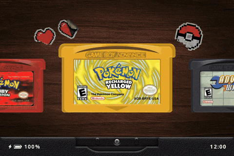
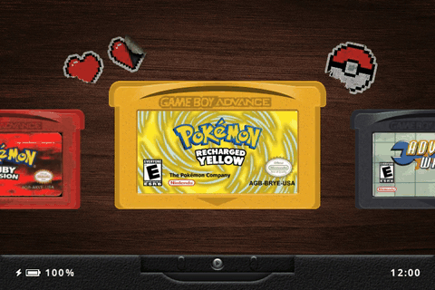

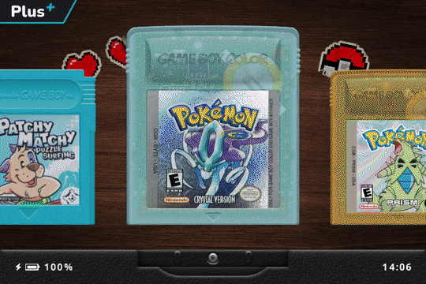
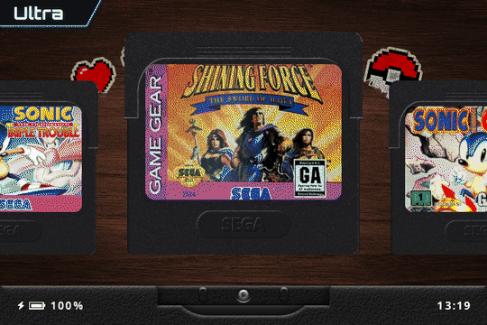

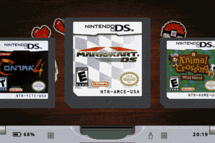
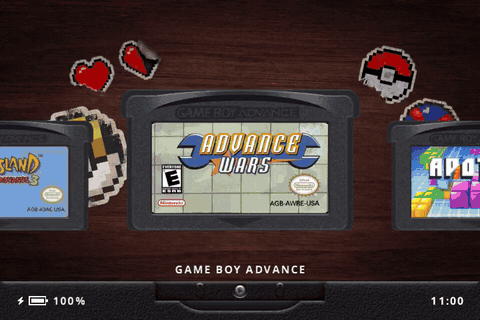

---

# Supported Devices

| Device             | Supported                                    | Since Version |
|--------------------|----------------------------------------------|---------------|
| Anbernic RG SP     | Yes                                          | Always        |
| Anbernic RG34XX    | Yes                                          | 1.4.0         |
| Anbernic RG34XXSP  | Yes                                          | 1.4.0         |
| Anbernic RG35XXSP  | Yes                                          | 1.5.0         |
| Anbernic 35XX Plus | Yes                                          | 1.5.0         |
| Anbernic RG28XX    | Yes                                          | 1.6.0         |
| Anbernic RG35XX-H  | Yes                                          | 1.7.0         |

If you have one of the untested devices, or have tried slot on a device not listed,
please [open an issue on GitHub](https://github.com/BrandonKowalski/slot/issues) and let me know how it went.

---

# Discord Community

slot has a [Discord server](https://discord.gg/NYRWsSuPUu) for questions, sharing setups, and talking about the project.

It is open to everyone in the slot universe. That includes folks running or building forks of slot.

There is no reason for this community to be fragmented so long as we are having fun!

---

# AI Disclosure

The Rust frontend, and the SVGs on [slot-cfw.fyi](https://slot-cfw.fyi), were put together by Claude.
I reviewed everything that was produced. All documentation is 100% free-range, meatbag prose.

My goal with this project was to recreate the feeling of playing my GBA SP in the back seat as a kid,
but with a few modern creature comforts.

Nothing about this project is exciting or groundbreaking from a technological perspective, and as a
result, I delegated the glue code. mGBA and gpSP have been around forever and are the true stars of
this show. The incredible skeuomorphic art is the work of [Markus](https://github.com/MarkusMaribu), an
artist who saw the bare-bones version and offered to dress it up.

I understand if my use of AI is a dealbreaker for you. Just know it's the least interesting part of
what's here.

Figured I should share the end result of all the wasted water. ✌🏻

---

# Spread Joy!

I've spent a lot of time building slot.

If you enjoy using it and feel inclined to pay it forward, go do something nice for someone! ❤️
